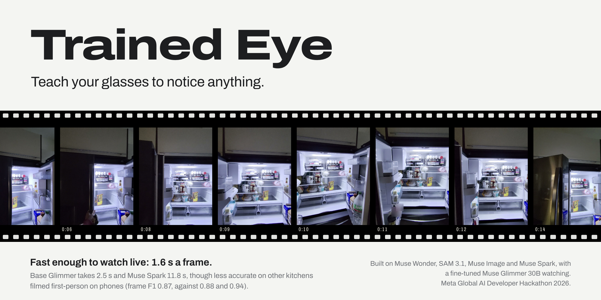
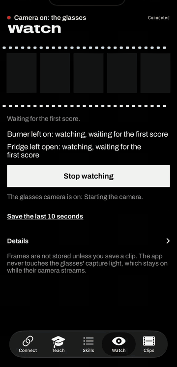
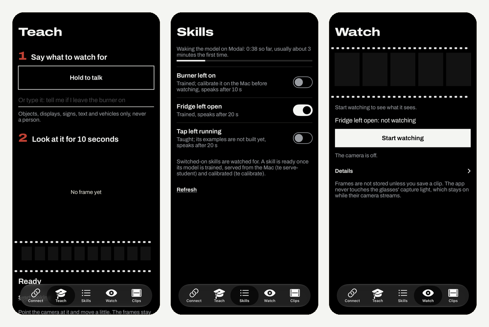
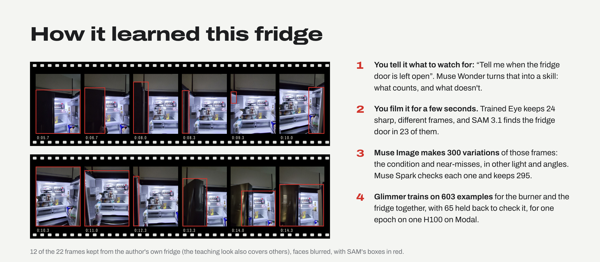

<p align="center"></p>

<p align="center">
  <b>Look at something for a few seconds, say what to watch for, and your Meta glasses speak up when it happens.</b><br>
  <sub>Built for the Meta Global AI Developer Hackathon · October 29 to November 4, 2026</sub>
</p>

<p align="center">
  <a href="https://www.youtube.com/watch?v=wJPSF9HVyUw"><b>Watch the demo</b></a> ·
  <a href="https://aas2438--trained-eye-playground-web.us-east.modal.run"><b>Try the playground</b></a> ·
  <a href="https://huggingface.co/amaan784/trained-eye"><b>The model</b></a> ·
  <a href="#how-it-works">How it works</a> ·
  <a href="#results">Results</a> ·
  <a href="#quick-start">Run it</a> ·
  <a href="docs/developer-guide.md">Developer guide</a>
</p>

Meta glasses answer when you ask them something, but they can't keep an eye on anything
for you. Trained Eye turns one sentence and a short look into a small model of your own,
fine-tuned from Meta's open-weights Muse Glimmer, that watches for it and tells you.

<p align="center"></p>

<p align="center"><sub>Live on the glasses, sped up twice: the hold counts to 20 seconds, Muse Spark confirms the frame, and the glasses speak.</sub></p>

## How it works

1. **Teach.** Look at the thing and say what to watch for ("tell me when the fridge door
   is left open"). Muse Wonder turns the sentence into a skill, SAM 3.1 finds the target,
   and Muse Image generates about 300 variations by editing your own teaching frames: the
   condition, near-misses, other light and angles. Muse Spark checks every generated image
   and keeps only those that show what they were made to show. No outside images are used:
   the generated images all start from the frames you filmed.
2. **Train.** Muse Glimmer is fine-tuned on those examples with Meta's QLoRA recipe, on
   one GPU on Modal.
3. **Watch.** The glasses stream to your phone; the fine-tuned model scores a frame a
   second, and once the condition has lasted long enough, the glasses say so.

<p align="center"></p>

<sub>The blue arrows are the live path while watching: glasses to iPhone to Mac, the frame
scored by the fine-tuned model on Modal, and the chance of yes back to the Mac, which decides
whether to speak. The rest of the flow, in four diagrams: [how it works](https://aas2438--trained-eye-playground-web.us-east.modal.run/how-it-works).</sub>

<p align="center"></p>

<sub>The iPhone app on Nov 4: Teach, Skills while the model on Modal wakes up, and Watch.</sub>

<p align="center"></p>

## Links and docs

| | |
|---|---|
| **Demo video** | [YouTube: Trained Eye live on the glasses](https://www.youtube.com/watch?v=wJPSF9HVyUw): teaching, watching, the fridge and burner alerts spoken on the glasses, and a walkthrough of the code, training, results and Modal |
| **Model** | [Hugging Face: amaan784/trained-eye](https://huggingface.co/amaan784/trained-eye), the LoRA adapter for Muse Glimmer 30B with its model card |
| **Playground** | [Try it in a browser](https://aas2438--trained-eye-playground-web.us-east.modal.run): replayed clips, how each skill learned, and teaching a skill live |
| **Training runs** | [Weights and Biases: trained-eye](https://wandb.ai/amaan784-columbia-university/trained-eye) |
| **Code** | [github.com/amaan784/trained-eye](https://github.com/amaan784/trained-eye) |
| **Results** | [phone clips, the main test](eval/results.md), [EPIC-KITCHENS](eval/epic/results.md) |
| **Developer guide** | [docs/developer-guide.md](docs/developer-guide.md): devices, keys, teach, train, serve, the iPhone app, the glasses |
| **How it works** | [Architecture](docs/architecture.md) and [the flow in diagrams](https://aas2438--trained-eye-playground-web.us-east.modal.run/how-it-works) (source: [docs/how-it-works.html](docs/how-it-works.html)) |
| **Evaluation method** | [docs/evaluation.md](docs/evaluation.md) |
| **Privacy and policy** | [docs/privacy-and-policy.md](docs/privacy-and-policy.md) |
| **Data and licenses** | [docs/data-and-licenses.md](docs/data-and-licenses.md), with the EPIC-KITCHENS-100 credit |
| **iPhone app** | [ios/README.md](ios/README.md) and the [glasses check](docs/glasses-check.md) |
| **Setup and keys** | [docs/setup.md](docs/setup.md) and [SETUP.md](SETUP.md) |
| **Recording protocol** | [docs/recording-protocol.md](docs/recording-protocol.md) |
| **Credits and notes** | [credits](CONTRIBUTIONS.md), [progress](PROGRESS.md), [handover](HANDOVER.md) |

<!-- te eval: results start (written by te eval --readme; edits here are lost) -->
## Results

Every number below comes from the evaluation scripts; the full tables are in [eval/results.md](eval/results.md). n/a means there was nothing to compute it from.

Test footage: other kitchens filmed first-person on phones (handheld; four fridges and two stoves the model was not taught on; labels drafted by an AI assistant, see docs/evaluation.md). Results on other footage are reported apart.

In short: on other kitchens filmed first-person on phones, the fine-tuned model spotted the condition about as accurately as base Glimmer and less accurately than Muse Spark (frame F1 0.87, 0.88 and 0.94), answering in 1.64 s a frame against 2.53 s and 11.80 s, at $4.00 an hour against $16.53 for Spark.

By skill, the fine-tuned model was the least accurate of the three on burner_left_on (frame F1 0.64, against 0.79 for base Glimmer and 0.97 for Muse Spark) and the most accurate of the three on fridge_left_open (frame F1 0.95, against 0.91 and 0.92). burner_left_on has no calibration clip, so the fine-tuned model runs it at the default threshold, 0.50.

Thresholds were calibrated for frame F1 on calibration clips (this footage has too few events past the skill's hold to judge alerts), so read the frame columns.

An event is caught on time when its alert comes within the skill's window after the skill's hold ends (the condition must stay true that long before it alerts): burner_left_on, a 10 s hold and a 5 s window; fridge_left_open, a 20 s hold and a 10 s window.

### Experiment 4: fine-tuned Glimmer, base Glimmer, Muse Spark on every frame

| Judge (all skills) | Frame F1 | Frame accuracy | Events caught on time | False alarms per hour | Dollars per hour |
|---|---|---|---|---|---|
| finetuned | 0.87 | 0.87 | 0.40 | 5.2 | $4.00 |
| base | 0.88 | 0.87 | 0.60 | 5.2 | $4.05 |
| spark | 0.94 | 0.93 | 0.60 | 10.4 | $16.53 |

Charts: [Experiment 4 (cost)](eval/exp4_cost.svg).

Regression check: not run yet (te regress).

Muse Spark's label error rate against hand labels (Experiment 2):

- burner_left_on: not measured yet (te spark-errors)
- fridge_left_open: not measured yet (te spark-errors)
<!-- te eval: results end -->

Of the four planned experiments, two ran: Experiment 1 (trained on the teaching clip's frames and generated images, against a model trained on EPIC's own frames) and Experiment 4 (the fine-tuned model against base Glimmer and Muse Spark on every frame). Experiment 2 (keeping only the generated images Muse Spark agreed with, or all of them) and Experiment 3 (how many generated images a skill needs) were not run in time. On EPIC-KITCHENS below, the fine-tuned model is the morning's fridge-only model, `exp1-mixed`, apart from the one `product` row.

<!-- te eval: results start: Results on EPIC-KITCHENS-100 (written by te eval --readme; edits here are lost) -->
## Results on EPIC-KITCHENS-100

Every number below comes from the evaluation scripts; the full tables are in [eval/epic/results.md](eval/epic/results.md). n/a means there was nothing to compute it from.

Test footage: other kitchens (EPIC-KITCHENS-100, head-mounted camera). Results on other footage are reported apart.

In short: on other kitchens, the fine-tuned model spotted the condition about as accurately as base Glimmer and Muse Spark (frame F1 0.88, 0.89 and 0.86), answering in 0.98 s a frame against 2.07 s and 11.16 s, at $3.95 an hour against $16.53 for Spark.

Thresholds were calibrated for frame F1 on calibration clips (this footage has too few events past the skill's hold to judge alerts), so read the frame columns.

An event is caught on time when its alert comes within the skill's window after the skill's hold ends (the condition must stay true that long before it alerts): fridge_left_open, a 20 or 30 s hold and a 10 s window.

### Experiment 1: real frames only, generated images only, or both

| Variant | Skill | Frame F1 | Events caught on time | False alarms per hour | Dollars per hour |
|---|---|---|---|---|---|
| mixed | fridge_left_open | 0.88 | 0.20 | 0.0 | $3.95 |
| real, other kitchens (EPIC, never published) | fridge_left_open | 0.89 | 0.20 | 0.0 | $3.95 |
| mixed, three fridges and two stoves | fridge_left_open | 0.75 | 0.00 | 0.0 | $3.95 |

### Experiment 4: fine-tuned Glimmer, base Glimmer, Muse Spark on every frame

| Judge (all skills) | Frame F1 | Frame accuracy | Events caught on time | False alarms per hour | Dollars per hour |
|---|---|---|---|---|---|
| finetuned | 0.88 | 0.96 | 0.20 | 0.0 | $3.95 |
| base | 0.89 | 0.96 | 0.20 | 0.0 | $3.95 |
| spark | 0.86 | 0.95 | 0.20 | 0.0 | $16.53 |

Charts: [Experiment 1](eval/epic/exp1_bars.svg), [Experiment 4 (cost)](eval/epic/exp4_cost.svg).

Regression check: not run yet (te regress).

Muse Spark's label error rate against hand labels (Experiment 2):

- fridge_left_open: not measured yet (te spark-errors)
<!-- te eval: results end: Results on EPIC-KITCHENS-100 -->

## Limitations, in plain words

- **Accuracy:** overall the fine-tuned model is about as accurate as base Glimmer, and faster. It is the best of the three on the fridge and the weakest on the burner, so it is not an accuracy gain on every skill.
- **Only what it can see:** it watches while the thing is in view. Look away and it cannot tell whether the burner is still on.
- **Unconfirmed alerts, on purpose:** if Muse Spark's check fails outright (an error, not a no), the alert is still spoken and logged as unconfirmed, so a cloud outage never silences a burner alert. A no from Spark does hold the alert back.
- **Home network only:** teaching needs the `SERVER_TOKEN`, but watching and waking the model do not yet, so run `te serve` only on a network you trust.
- **Untrained skills:** a skill the served model was not trained on can still be switched on; the server logs a warning and its scores mean little.
- **Evidence:** the test labels were drafted by an AI assistant, too few events lasted past the hold to judge alerts well, and Experiments 2 and 3 did not run. Validation during training was split by example, not by source frame; the separate test footage is not affected.

<!-- art: models start (written by python -m backend.art.build; edits here are lost) -->
## Meta models, each with a job

| Model | Its job | In this run |
|---|---|---|
| Muse Wonder (`muse-wonder-1.0`) | Turns the request into a skill: what to watch, what counts, what does not. | 1 skill from 1 sentence |
| SAM 3.1 (`sam-3.1`) | Finds the target in the teaching frames. | 23 of 24 teaching frames boxed |
| Muse Image (`muse-image-1.0`) | Makes the variations: the condition, near-misses, other light and angles. | 300 variations made |
| Muse Spark (`muse-spark-1.3`) | Labels every image and keeps the ones it agrees with. | 324 images labelled, 295 variations kept |
| **Muse Glimmer 30B** (`meta-models/Muse-Glimmer-30B`), fine-tuned | Fine-tuned, open weights: watches every frame. | 603 training examples, one epoch |
<!-- art: models end -->

## Quick start

    brew install python@3.12 ffmpeg
    python3.12 -m venv .venv && source .venv/bin/activate
    pip install -e ".[dev,train]"
    cp .env.example .env        # add your Meta API key
    te teach --skill fridge_left_open --clip teach.mp4 --request "Tell me when the fridge door is left open"
    te train --skills fridge_left_open --run my-fridge --smoke
    te train --skills fridge_left_open --run my-fridge
    te export --run my-fridge          # merge the adapter into the base on Modal
    te serve-student --run my-fridge   # serve it on Modal; put its URL + /v1 in .env as TE_STUDENT_URL
    te serve                           # then connect the iPhone app

Before relying on alerts, calibrate the skill's threshold on a labelled clip of your own
(`te calibrate`, in the developer guide); until then it uses 0.5. The released model,
`product`, was made the same way from the fridge and the burner together.

Every paid step prints its price and asks first. [docs/developer-guide.md](docs/developer-guide.md)
walks the whole path, from a fresh Mac to an alert spoken on your glasses;
[docs/setup.md](docs/setup.md) and [SETUP.md](SETUP.md) have the accounts and keys.

## Try it

- **In a browser:** the [playground](https://aas2438--trained-eye-playground-web.us-east.modal.run) shows how
  each skill was learned (its teaching frames with SAM's boxes and the four steps), the
  results, and lets you teach one live. It can also replay recorded clips with the model's
  scores; the public copy has none published yet.
- **On your own glasses:** the iPhone app is a developer build for now. You need a Mac
  (Xcode 26.4 or newer), an iPhone (iOS 17.2 or newer), Meta AI glasses with Developer Mode
  on in the Meta AI app, all on one Wi-Fi network, plus your own Meta API key and Modal
  account ([docs/developer-guide.md](docs/developer-guide.md)).
- **With an iPhone only:** on the Connect screen, set Camera to iPhone and the app watches
  with the phone's own camera. The app has to stay open (iOS stops the camera in the
  background), and alerts are spoken only through Bluetooth audio such as earbuds;
  otherwise they show on screen. This path is in the app but was not tried on a phone on
  Nov 4; the glasses were.
- **Training runs:** every run, with its loss curves, is in the
  [Weights and Biases project](https://wandb.ai/amaan784-columbia-university/trained-eye).

Built for the Meta Global AI Developer Hackathon (October 29 to November 4, 2026). This project's code was written during the event, except two files in `ios/TrainedEye/Meta/` copied from Meta's CameraAccess sample (Meta Wearables Device Access Toolkit for iOS 1.0.1, under Meta's Wearables Developer Terms), and the training config, which keeps the values of Meta's QLoRA recipe for Muse Glimmer 30B from meta-oss-cookbook (Apache-2.0). [CONTRIBUTIONS.md](CONTRIBUTIONS.md) lists each one. MIT license, see [LICENSE](LICENSE); the base model is under its own (Apache-2.0).

## Citation

If you use Trained Eye, its code or its model, please cite it. GitHub's "Cite this
repository" button gives the same from [CITATION.cff](CITATION.cff).

```bibtex
@software{sheikh2026trainedeye,
  author = {Sheikh, Amaan},
  title  = {Trained Eye: Teach Your Glasses to Notice Anything},
  year   = {2026},
  month  = nov,
  url    = {https://github.com/amaan784/trained-eye},
  note   = {Model: https://huggingface.co/amaan784/trained-eye. Built for the Meta Global AI Developer Hackathon}
}
```

Amaan Sheikh. *Trained Eye: Teach Your Glasses to Notice Anything.* 2026.
https://github.com/amaan784/trained-eye
