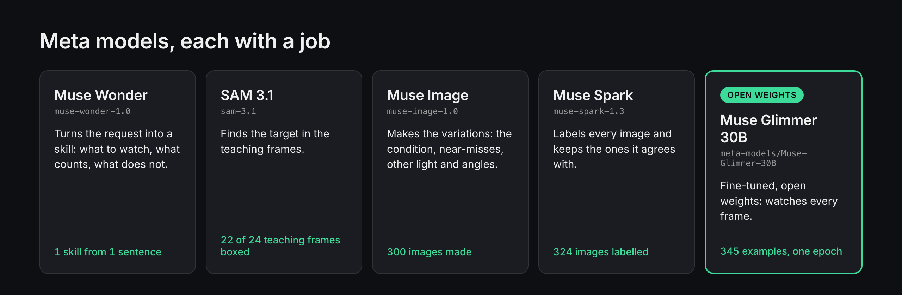

# Trained Eye

**Look at something for a few seconds, say what to watch for, and your Meta glasses speak
up when it happens.**

Meta glasses answer when you ask them something, but they can't keep an eye on anything
for you. Trained Eye turns one sentence and a short look into a small model of your own,
fine-tuned from Meta's open-weights Muse Glimmer, that watches for it and tells you.

## How it works

1. **Teach.** Look at the thing and say what to watch for ("tell me when the fridge door
   is left open"). Muse Wonder turns the sentence into a skill, SAM 3.1 finds the target,
   Muse Image makes variations of what you showed, and Muse Spark labels every one.
2. **Train.** Muse Glimmer is fine-tuned on those examples with Meta's QLoRA recipe, on
   one GPU on Modal.
3. **Watch.** The glasses stream to your phone; the fine-tuned model scores a frame a
   second, and once the condition has lasted long enough, the glasses say so.

<!-- te eval: results start (written by te eval --readme; edits here are lost) -->
## Results

Written by `te eval --readme` from `eval/results.json` (SHA-256 `b6700ca944f8fcb23ab2883625812d15848dc7442c9011f43733e5d2704e9bc5`): 3 of 3 evaluations scored. Every number here is copied from that file; n/a means there was nothing to compute it from.

Test footage: other kitchens (EPIC-KITCHENS-100, head-mounted camera). Results on other footage are reported apart.

Thresholds were calibrated for frame F1 on calibration clips (this footage has too few events past the skill's hold to judge alerts), so read the frame columns.

An event is caught on time when its alert comes within the skill's window after the skill's hold ends (the condition must stay true that long before it alerts): fridge_left_open, a 30 s hold and a 10 s window.

### Experiment 4: fine-tuned Glimmer, base Glimmer, Muse Spark on every frame

| Judge (all skills) | Frame F1 | Frame accuracy | Events caught on time | False alarms per hour | Dollars per hour |
|---|---|---|---|---|---|
| finetuned | 0.88 | 0.96 | 0.20 | 0.0 | $3.95 |
| base | 0.89 | 0.96 | 0.20 | 0.0 | $3.95 |
| spark | 0.86 | 0.95 | 0.20 | 0.0 | $16.32 |

Charts: [Experiment 4 (cost)](eval/exp4_cost.svg).

Regression check: not run yet (te regress).

Muse Spark's label error rate against hand labels (Experiment 2):

- fridge_left_open: not measured yet (te spark-errors)
<!-- te eval: results end -->

## Quick start

    brew install python@3.12 ffmpeg
    python3.12 -m venv .venv && source .venv/bin/activate
    pip install -e ".[dev,train]"
    cp .env.example .env        # add your Meta API key
    te teach --skill fridge_left_open --clip teach.mp4 --request "Tell me when the fridge door is left open"
    te train --skills fridge_left_open --run exp1-mixed --smoke
    te train --skills fridge_left_open --run exp1-mixed
    te serve                    # then connect the iPhone app

Every paid step prints its price and asks first. [docs/setup.md](docs/setup.md) has the
details and [SETUP.md](SETUP.md) the accounts and keys.

## Documentation

- [Architecture](docs/architecture.md): the teach flow, training and serving, watch mode,
  and every module
- [How it works, with diagrams](docs/how-it-works.html)
- [Setup](docs/setup.md) and [accounts and keys](SETUP.md)
- [Evaluation method](docs/evaluation.md) and the [full results](eval/results.md)
- [Privacy and policy](docs/privacy-and-policy.md)
- [Data and licenses](docs/data-and-licenses.md), with the EPIC-KITCHENS-100 credit
- [Recording protocol](docs/recording-protocol.md)
- [Glasses check](docs/glasses-check.md)
- [iOS app build](ios/README.md)
- [Credits](CONTRIBUTIONS.md), [progress](PROGRESS.md) and [handover notes](HANDOVER.md)

Built for the Meta Global AI Developer Hackathon (October 29 to November 4, 2026). All
code here was written during the event. MIT license, see [LICENSE](LICENSE); the base model is under its own (Apache-2.0).
