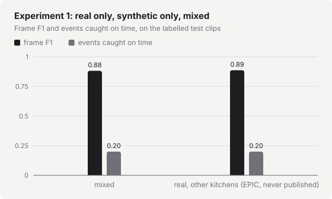
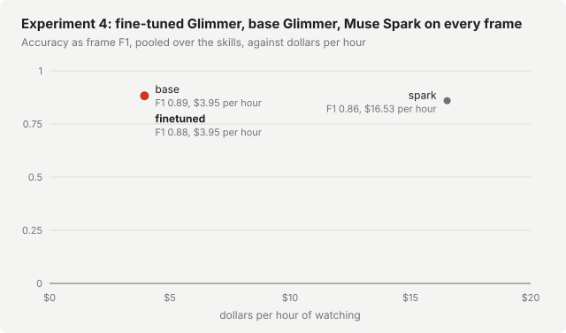

# Evaluation results: other kitchens (EPIC-KITCHENS-100, head-mounted camera)

Test footage: other kitchens (EPIC-KITCHENS-100, head-mounted camera). Results on other footage are reported apart.

Thresholds here were calibrated for frame F1 on the calibration clips, not for alerts: this footage has too few events that last past the skill's hold to judge alerts on, so read the frame columns.

Computed by `te eval` from the plan plan-epic.json: the frame logs of `te watch` scored against the human labels of each test clip. Every number below comes from that computation, and results.json holds all of them. n/a means there was nothing to compute it from (for example, no alerts give no time to alert).

How to read the tables: a frame counts as yes when the student's probability is at or over the skill's threshold, shown with where it came from (run: the run's own calibration on its validation clips; skill: the skill-wide one; flag: given by hand; default: 0.5, not calibrated; spark: only a yes). A skill alerts only once its condition has stayed true for the skill's hold, so an event is one labelled true range that lasts at least the hold, and its alert is due when the hold ends. It is caught on time when its first alert after that comes within the skill's on-time window: fridge_left_open, a 20 or 30 s hold and a 10 s window. False alarms are alerts no event explains: on frames labelled false, or before the hold ended. Dollars per hour add the student's GPU (nothing on the Mac), the Muse Spark checks and any per-frame scorer, at the prices in the plan.

## Experiment 1: real frames only, generated images only, or both

| Run | Variant | Skill | Clips | Footage | Frames | Precision | Recall | F1 | Events caught on time | Events caught at all | False alarms per hour | Time to alert after the hold, median (mean) | Threshold (from) |
|---|---|---|---|---|---|---|---|---|---|---|---|---|---|
| epic-exp1-mixed-fridge_left_open | mixed | fridge_left_open | 11 | 23.4 min | 1405 | 0.98 | 0.80 | 0.88 | 1 of 5 | 1 of 5 | 0.0 | 1.0 s (1.0 s) | 0.62 (run) |
| epic-exp1-epic-fridge_left_open | real, other kitchens (EPIC, never published) | fridge_left_open | 11 | 23.4 min | 1405 | 0.98 | 0.81 | 0.89 | 1 of 5 | 1 of 5 | 0.0 | 1.0 s (1.0 s) | 0.82 (run) |
| epic-product-fridge_left_open | mixed, three fridges and two stoves | fridge_left_open | 11 | 23.4 min | 1405 | 0.99 | 0.60 | 0.75 | 0 of 6 | 1 of 6 | 0.0 | 20.0 s (20.0 s) | 0.83 (run) |

Speed and cost:

| Run | Latency median | Latency p90 | Student errors | Alerts | Spark checks per hour | Dollars per hour | Prices used |
|---|---|---|---|---|---|---|---|
| epic-exp1-mixed-fridge_left_open | 0.98 s | 1.33 s | 0 | 1 | 0.0 | $3.95 | GPU $3.95 per hour, $0.005 per Spark check |
| epic-exp1-epic-fridge_left_open | 0.93 s | 1.15 s | 0 | 1 | 0.0 | $3.95 | GPU $3.95 per hour, $0.005 per Spark check |
| epic-product-fridge_left_open | 0.69 s | 1.03 s | 0 | 1 | 0.0 | $3.95 | GPU $3.95 per hour, $0.005 per Spark check |

## Experiment 2: labels filtered by Muse Spark, or not

No runs yet: the plan has no evaluations for this experiment.

Muse Spark's labels against your hand labels (te spark-errors, 95% Wilson intervals), and how often Spark agreed with the label each generated image was made for (te teach's label_stats.json; the filter keeps those):

| Skill | Hand-labelled | Spark wrong | Spark unsure | Generated-for label wrong (unfiltered arm) | Kept by the filter but wrong (filtered arm) | Spark agreed with the label |
|---|---|---|---|---|---|---|
| fridge_left_open | not measured yet (te label --skill, then te spark-errors) | n/a | n/a | n/a | n/a | 295 of 300 kept (98.3%) |

## Experiment 3: how many generated images

No runs yet: the plan has no evaluations for this experiment.

## Experiment 4: fine-tuned Glimmer, base Glimmer, Muse Spark on every frame

| Run | Variant | Skill | Clips | Footage | Frames | Precision | Recall | F1 | Events caught on time | Events caught at all | False alarms per hour | Time to alert after the hold, median (mean) | Threshold (from) | Frame accuracy |
|---|---|---|---|---|---|---|---|---|---|---|---|---|---|---|
| epic-exp4-finetuned-fridge_left_open | finetuned | fridge_left_open | 11 | 23.4 min | 1405 | 0.98 | 0.80 | 0.88 | 1 of 5 | 1 of 5 | 0.0 | 1.0 s (1.0 s) | 0.62 (run) | 0.96 |
| epic-exp4-base-fridge_left_open | base | fridge_left_open | 11 | 23.4 min | 1405 | 1.00 | 0.80 | 0.89 | 1 of 5 | 1 of 5 | 0.0 | 1.0 s (1.0 s) | 0.50 (run) | 0.96 |
| epic-exp4-spark-fridge_left_open | spark | fridge_left_open | 11 | 23.4 min | 1405 | 1.00 | 0.76 | 0.86 | 1 of 5 | 1 of 5 | 0.0 | 1.0 s (1.0 s) | 1.00 (spark) | 0.95 |

Speed and cost:

| Run | Latency median | Latency p90 | Student errors | Alerts | Spark checks per hour | Dollars per hour | Prices used |
|---|---|---|---|---|---|---|---|
| epic-exp4-finetuned-fridge_left_open | 0.98 s | 1.33 s | 0 | 1 | 0.0 | $3.95 | GPU $3.95 per hour, $0.005 per Spark check |
| epic-exp4-base-fridge_left_open | 2.07 s | 2.76 s | 0 | 1 | 0.0 | $3.95 | GPU $3.95 per hour, $0.005 per Spark check |
| epic-exp4-spark-fridge_left_open | 11.16 s | 16.26 s | 0 | 1 | 0.0 | $16.53 | GPU $0.00 per hour, $0.005 per frame scored |

Pooled over the skills (the cost chart's points; dollars per hour weighted by hours of footage):

| Judge | Skills | Frames | F1 | Frame accuracy | Events caught on time | False alarms per hour | Dollars per hour |
|---|---|---|---|---|---|---|---|
| finetuned | fridge_left_open | 1405 | 0.88 | 0.96 | 1 of 5 | 0.0 | $3.95 |
| base | fridge_left_open | 1405 | 0.89 | 0.96 | 1 of 5 | 0.0 | $3.95 |
| spark | fridge_left_open | 1405 | 0.86 | 0.95 | 1 of 5 | 0.0 | $16.53 |

Why the speeds differ (`python -m backend.eval.speed`, the student's own request sent one frame at a time, on frames of P03_19_00093): every token a model writes before its yes or no costs time on the GPU.

| Model | Completion tokens a frame (median) | Frames with reasoning text | Seconds a frame, one at a time (median) |
|---|---|---|---|
| finetuned | 5 | 0 of 20 | 0.99 s |
| base | 64 | 20 of 20 | 1.78 s |

## Regression check

Not run yet: te regress writes eval/regression.json.

## Failure galleries (local only)

The worst false alarms and misses of each Experiment 1 run, as frames of the recorded test clips. They may show faces, so they stay on this Mac: run te blur on any frame before publishing it.

- [exp1-mixed](galleries/exp1-mixed/index.html): 3 false alarms and 28 misses shown
- [exp1-epic](galleries/exp1-epic/index.html): 3 false alarms and 27 misses shown
- [product](galleries/product/index.html): 1 false alarms and 39 misses shown
